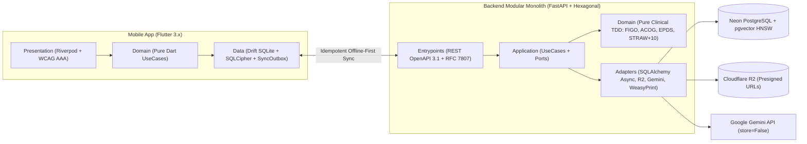

# Cora — Plataforma Integral y Preventiva de Salud Femenina

**Cora** es un ecosistema móvil *Offline-First* diseñado para acompañar a la mujer de manera continua, empática y basada en evidencia científica a lo largo de las **7 etapas biológicas de su vida**, preservando un historial clínico longitudinal único sin pérdida de contexto entre transiciones vitales.

---

## Visión Funcional: 7 Etapas Biológicas + Núcleo Transversal

Cora adapta su motor clínico, tono comunicacional y paneles interactivos mediante una máquina de estados longitudinal (`LifeStageStateMachine`):

1. **Adolescencia (~10–19 años):** *Mi Primer Periodo*, guía de cambios corporales libre de estigmas, algoritmo tolerante a irregularidad posmenarquia y modo de privacidad con PIN independiente.
2. **Juventud y Edad Reproductiva (~20–39 años):** Mapeo de 4 fases hormonales, gestión anticonceptiva, seguimiento adaptado a **SOP** y **Endometriosis**, y detección preventiva de patrones atípicos según criterios **FIGO**.
3. **Búsqueda de Concepción:** Registro sintotérmico avanzado (temperatura basal corporal, moco cervical, pruebas de LH), preparación preconcepcional y consolidado para especialistas en fertilidad.
4. **Embarazo:** Desarrollo fetal semana a semana, monitor materno de presión arterial, peso y glucosa con alertas preventivas **ACOG** (preeclampsia y diabetes gestacional), contador de contracciones, monitor de patadas y plan de parto.
5. **Posparto y Crianza Inicial (Cuarto Trimestre):** Evolución de loquios y cicatrices, apoyo ergonómico a la lactancia y banco de leche, y despistaje validado de depresión posparto (**Escala de Edimburgo — EPDS**).
6. **Perimenopausia y Menopausia (~40–55+ años):** Seguimiento de transición **STRAW+10**, mapa de sofocos diurnos/nocturnos y sueño, control de impacto de **TRH** y salud cardiometabólica.
7. **Plenitud / Adulta Mayor:** Prevención de osteopenia/osteoporosis y riesgo de caídas, salud uroginecológica, interfaz de **Alta Legibilidad (WCAG AAA)** y botón directo de contacto familiar/soporte.

### Capacidades Transversales y Diferenciales
- **Carpeta Clínica Digital y *Doctor-Ready PDF*:** Almacenamiento privado de exámenes en **Cloudflare R2**, cartilla de vacunación y exportación de resúmenes médicos de 1–2 páginas renderizados con **WeasyPrint**.
- **Asistente Conversacional Clínico (RAG):** Triaje de urgencias sub-milisegundo (`DeterministicSafetyInterceptor`) + cruce del historial privado con literatura científica validada (OMS, ACOG, FIGO, NAMS) sobre **Neon `pgvector`** y **Google Gemini API (`gemini-3.8-flash` + `gemini-embedding-2`, `store=False`)**.
- **Modo Acompañante (*Partner View*) y Modo Discreto:** Compartición selectiva revocable en tiempo real, bloqueo biométrico, icono camuflable, notificaciones neutras y soberanía total de datos (exportación portable y purga irreversible).

---

## Arquitectura e Ingeniería

### Stack Tecnológico Principal

| Capa | Tecnología |
| :--- | :--- |
| **Móvil (iOS / Android)** | Flutter 3.x, Dart 3.x, **Riverpod** (`AsyncNotifier`), **Drift** (SQLite + SQLCipher *Offline-First*) |
| **Backend API** | Python 3.12+, **FastAPI**, Pydantic v2, **SQLAlchemy 2.0 Async** (`asyncpg`), **Alembic** |
| **Datos y Búsqueda Vectorial** | **Neon Serverless PostgreSQL** + **`pgvector`** (índice HNSW) |
| **IA Clínica y Reportes** | **`google-genai >= 2.30.1`** (`gemini-3.8-flash` + `gemini-embedding-2`), **WeasyPrint** + **Jinja2** |
| **Seguridad y Almacenamiento** | **Firebase Authentication** (JWT), **Cloudflare R2** (S3-compatible *zero-egress*) |
| **Calidad y Automatización** | SDD (OpenAPI Contract-First), TDD Biomédico, Docker, **GitHub Actions CI/CD** |

---

## Estructura Documental y Desarrollo por Fases

El desarrollo está estructurado en **12 fases modulares**, diseñadas para ejecutarse sesión por sesión con reglas estrictas de arquitectura, pruebas y commits atómicos:

- **Especificación de Producto:** [docs/SPECS.MD](./docs/SPECS.MD)
- **Especificación Técnica y Arquitectura:** [docs/desarrollo.md](./docs/desarrollo.md)
- **Guía de Despliegue y Lanzamiento v1.0.0:** [docs/DEPLOYMENT_AND_RELEASE.md](./docs/DEPLOYMENT_AND_RELEASE.md)
- **Reglas del Agente y Estándares de Ingeniería:** [AGENTS.md](./AGENTS.md) y [.agents/rules/](./.agents/rules/)
- **Hoja de Ruta Maestra (Fases 01 a 12):** [docs/phases/README.md](./docs/phases/README.md)
- **Bitácora de Documentación por Fase Completada:** [documentacion/README.md](./documentacion/README.md)

| Fase | Plan Detallado | Enfoque |
| :--- | :--- | :--- |
| **01** | [phase-01-foundation-and-cicd.md](./docs/phases/phase-01-foundation-and-cicd.md) | Monorepo `backend/` + `mobile/`, Docker `pgvector`, `SyncCoordinator` y GitHub Actions CI/CD |
| **02** | [phase-02-identity-onboarding-lifestage.md](./docs/phases/phase-02-identity-onboarding-lifestage.md) | Firebase JWT, Onboarding de 3 Capas, `LifeStageStateMachine` y *Home Dashboard* dinámico |
| **03** | [phase-03-wellness-and-treatments.md](./docs/phases/phase-03-wellness-and-treatments.md) | Registro diario de Bienestar/Hábitos y Gestor de Tratamientos/Fármacos *Offline-First* |
| **04** | [phase-04-cycle-reproductive-adolescence.md](./docs/phases/phase-04-cycle-reproductive-adolescence.md) | Etapas 1 y 2: Ciclo de 4 fases, Adolescencia + PIN, SOP/Endometriosis y alertas **FIGO** |
| **05** | [phase-05-fertility-and-conception.md](./docs/phases/phase-05-fertility-and-conception.md) | Etapa 3: Fertilidad sintotérmica (TBC, moco cervical, LH) y preparación preconcepcional |
| **06** | [phase-06-pregnancy-maternal-care.md](./docs/phases/phase-06-pregnancy-maternal-care.md) | Etapa 4: Embarazo semana a semana, alertas **ACOG** (preeclampsia/DG), contracciones y patadas |
| **07** | [phase-07-postpartum-lactation-mental-health.md](./docs/phases/phase-07-postpartum-lactation-mental-health.md) | Etapa 5: Recuperación posparto, lactancia/banco de leche y tamizaje **EPDS** |
| **08** | [phase-08-menopause-and-senior-vitality.md](./docs/phases/phase-08-menopause-and-senior-vitality.md) | Etapas 6 y 7: Transición **STRAW+10**, sofocos, TRH, salud ósea/caídas y UI WCAG AAA |
| **09** | [phase-09-medical-records-r2-pdf.md](./docs/phases/phase-09-medical-records-r2-pdf.md) | Carpeta Clínica Digital, vacunas, Cloudflare R2 y reportes **Doctor-Ready PDF** |
| **10** | [phase-10-education-and-clinical-rag.md](./docs/phases/phase-10-education-and-clinical-rag.md) | Biblioteca clínica curada, búsqueda `pgvector` HNSW, triaje determinista y chat RAG |
| **11** | [phase-11-partner-view-privacy-gdpr.md](./docs/phases/phase-11-partner-view-privacy-gdpr.md) | *Partner View* selectivo, SQLCipher, biometría, icono camuflable y purga irreversible GDPR |
| **12** | [phase-12-qa-e2e-security-release.md](./docs/phases/phase-12-qa-e2e-security-release.md) | Suite E2E completa, auditoría BOLA/prompt-injection, benchmarks y Release CD |
