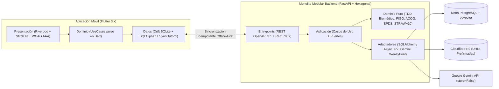

# Cora — Plataforma Integral y Preventiva de Salud Femenina

[](https://github.com/eduardoevz/Cora/actions/workflows/ci-backend.yml)
[](https://github.com/eduardoevz/Cora/actions/workflows/ci-mobile.yml)
[](https://github.com/eduardoevz/Cora/actions/workflows/security-and-contracts.yml)
[](https://github.com/eduardoevz/Cora/releases/latest)
[](LICENSE)
[](https://fastapi.tiangolo.com)
[](https://flutter.dev)
[](#arquitectura-e-ingeniería)

> **Cora** es un ecosistema de salud integral *Offline-First* diseñado para acompañar a la mujer de manera longitudinal, empática y basada en evidencia clínica a lo largo de las **7 etapas biológicas de su vida**. Ofrece sincronización local instantánea, triaje preventivo determinista y soberanía absoluta de datos personales y biomédicos.

---

## 📲 Descarga de la Aplicación Móvil (APK Oficial)

Puedes descargar e instalar directamente la última versión oficial de Cora en tu dispositivo Android:

[-2E6F40?style=for-the-badge&logo=android&logoColor=white)](https://github.com/eduardoevz/Cora/releases/download/v2.0.0/cora-v2.0.0-release.apk)

* **Versión:** `v2.0.0` (*Warm Botanical Health Editorial — Google Stitch Hybrid*)
* **Binario Universal:** `cora-v2.0.0-release.apk` (65.0 MB)
* **Compatibilidad:** Android 8.0 (API 26) o superior (Optimizado para Android 14/15 y pantallas de alta densidad)
* **Historial Completo de Versiones y Notas de Lanzamiento:** [GitHub Releases de Cora](https://github.com/eduardoevz/Cora/releases)

---

## 🌸 Las 7 Etapas Biológicas de la Mujer en Cora

Cora adapta dinámicamente sus paneles, algoritmos clínicos, vocabulario y niveles de contraste mediante la máquina de estados longitudinal `LifeStageStateMachine`:

1. **Adolescencia (~10–19 años):** *Mi Primer Periodo*, educación menstrual desestigmatizada, algoritmo tolerante a la variabilidad posmenarquia (21–45 días) y modo de privacidad con PIN independiente.
2. **Juventud y Edad Reproductiva (~20–39 años):** Mapeo de las 4 fases hormonales, calendario menstrual interactivo, gestión anticonceptiva, seguimiento especializado para **SOP** y **Endometriosis**, y detección preventiva de sangrado uterino anormal según criterios **FIGO**.
3. **Búsqueda de Concepción:** Registro sintotérmico avanzado (curva de Temperatura Basal Corporal con algoritmo 3-sobre-6, moco cervical y picos de LH), checklist preconcepcional y consolidado para especialistas en fertilidad.
4. **Embarazo:** Desarrollo fetal semana a semana, monitor materno de presión arterial con banderas rojas inmediatas de preeclampsia severa (**ACOG**), cronómetro de contracciones 5-1-1, contador de patadas (método Cardiff) y plan de parto.
5. **Posparto y Crianza Inicial (Cuarto Trimestre):** Evolución de loquios e involución uterina, cronómetro dual de lactancia y banco de leche FIFO, y tamizaje validado de salud mental posparto (**Escala de Edimburgo — EPDS**) con banner de crisis 24/7 si el ítem 10 es positivo.
6. **Perimenopausia y Menopausia (~40–55+ años):** Clasificación de transición hormonal **STRAW+10**, diario de sofocos con escala Greene, monitoreo de Terapia de Reemplazo Hormonal (TRH) y factores de riesgo cardiometabólico.
7. **Plenitud y Vitalidad Sénior:** Prevención de osteoporosis (T-Score DXA), prevención de caídas y fragilidad, salud uroginecológica, interfaz nativa de **Alta Legibilidad (WCAG AAA >= 7:1)** y botón directo de contacto de confianza.

---

## 🛡️ Capacidades Diferenciales y Soberanía

* **Arquitectura Offline-First Real:** Toda acción de registro persiste primero en la base de datos local **Drift (SQLite + SQLCipher)** y encola mutaciones idempotentes (`client_mutation_id`) en una bandeja de salida (`SyncOutboxService`). La aplicación funciona con 0% de conectividad.
* **Triaje Clínico Determinista (`DeterministicSafetyInterceptor`):** Ninguna consulta libre de urgencia llega al LLM. Los signos de alarma (hemorragia aguda, hipertensión severa en embarazo, ideación autolesiva en EPDS) activan derivación médica inmediata en sub-milisegundos.
* **IA RAG Clínica Ética y Privada:** Motor conversacional sobre literatura médica canónica indexada en **Neon PostgreSQL con `pgvector` (HNSW)** y **Google Gemini API** (`gemini-3.8-flash` + `gemini-embedding-2`) configurado con **`store=False`** (cero retención de datos clínicos para entrenamiento).
* **Carpeta Clínica Digital y *Doctor-Ready PDF*:** Almacenamiento seguro en **Cloudflare R2** (*zero-egress fees*) y exportación de resúmenes clínicos de alta fidelidad renderizados con **WeasyPrint** listos para entregar a la ginecóloga u obstetra.
* **Modo Acompañante (*Partner View*) y Modo Discreto:** Permisos granulares de sólo lectura para parejas, camuflaje de icono en el launcher de Android y eliminación irreversible de cuenta (**Derecho al Olvido / GDPR**) en un solo paso.

---

## 🏗️ Arquitectura e Ingeniería



### Stack Tecnológico

| Capa | Tecnología | Propósito |
| :--- | :--- | :--- |
| **Mobile** | Flutter 3.x / Dart 3.x | Multiplataforma nativa para iOS y Android |
| **Estado y Datos Locales** | Riverpod (`AsyncNotifier`) + Drift | Inmutabilidad, reactividad y persistencia *Offline-First* |
| **Backend API** | FastAPI / Python 3.12+ | Monolito modular hexagonal de alto rendimiento |
| **Persistencia y Vectores** | Neon Serverless PostgreSQL + `pgvector` | Base de datos relacional y búsqueda semántica HNSW |
| **IA y Modelos** | Google GenAI SDK (`gemini-3.8-flash`) | Asistente RAG con citations clínicas y `store=False` |
| **Almacenamiento Seguro** | Cloudflare R2 | Almacenamiento S3 de estudios médicos sin costos de salida |
| **Reportes Médicos** | WeasyPrint + Jinja2 | Generación determinista de reportes *Doctor-Ready PDF* |
| **Autenticación** | Firebase Authentication | Validación de tokens Bearer JWT en backend |

---

## 🚀 Puesta en Marcha en Local

### 1. Clonar el Repositorio
```bash
git clone https://github.com/eduardoevz/Cora.git
cd Cora
```

### 2. Backend (FastAPI)
```bash
cd backend
# Con uv (recomendado)
uv venv
uv sync
uv run pytest tests/unit -q
uv run uvicorn app.main:app --reload --port 8000
```

### 3. Aplicación Móvil (Flutter)
```bash
cd mobile
flutter pub get
flutter test
flutter run -d chrome # o emulador Android
```

---

## 📚 Documentación Técnica y Hoja de Ruta

* **Sistema de Diseño Semántico (Cora v2.0):** [`docs/DESIGN.md`](./docs/DESIGN.md)
* **Especificación Funcional Completa:** [`docs/SPECS.MD`](./docs/SPECS.MD)
* **Arquitectura y Estándares de Desarrollo:** [`docs/desarrollo.md`](./docs/desarrollo.md)
* **Guía de Despliegue en Producción (Render & Neon):** [`docs/DEPLOYMENT_AND_RELEASE.md`](./docs/DEPLOYMENT_AND_RELEASE.md)
* **Reporte de Auditoría y Certificación de Producción:** [`documentacion/auditoria-sistema-produccion.md`](./documentacion/auditoria-sistema-produccion.md)
* **Hoja de Ruta de Fases:** [`docs/phases/README.md`](./docs/phases/README.md) y Bitácora en [`documentacion/README.md`](./documentacion/README.md)

---

## 📄 Licencia

Este proyecto está bajo la Licencia [MIT](LICENSE). Todos los derechos reservados.
