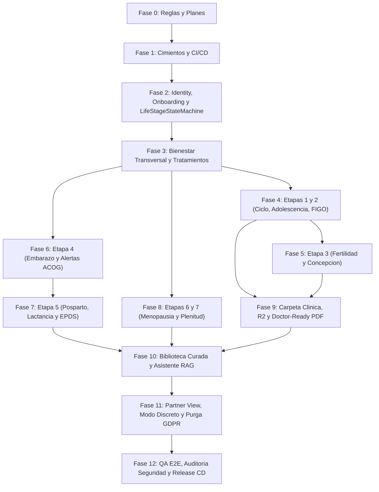

# Hoja de Ruta Maestra por Fases — Plataforma Cora

Este directorio contiene el plan de implementación completo de **Cora**, dividido en **12 fases autocontenidas** diseñadas para ejecutarse **una fase por sesión** dentro de Antigravity siguiendo TDD biomédico, Arquitectura Hexagonal, Clean Architecture *Offline-First*, SDD (OpenAPI → Dart) y CI/CD en GitHub Actions.

---

## Cómo Ejecutar Cada Fase en una Nueva Sesión de Antigravity

Al abrir una nueva conversación en Antigravity para avanzar con la siguiente etapa del proyecto, utiliza esta instrucción:

> `/plan Ejecutemos la Fase X siguiendo estrictamente docs/phases/phase-0X-<nombre>.md y las reglas en .agents/rules/. Verifica cada tarea con tests reales, realiza todos los commits atómicos indicados y haz push al repositorio público eduardoevz/Cora.`

Al finalizar cada sesión:
1. Todas las tareas (`- [x]`) del archivo de la fase deben quedar marcadas.
2. Se debe crear el reporte completo de lo implementado en [`documentacion/fase-XX-<nombre>.md`](../../documentacion/README.md) y actualizar su índice.
3. Se debe hacer push a `origin/main` y verificar en vivo (`gh run list` / `gh run watch`) que **todos los pipelines de CI en GitHub Actions pasen en verde (`success`)**.
4. **Regla de Cierre Innegociable:** Si algún CI falla, el agente está obligado a resolverlo en la misma sesión antes de dar por cerrada la fase (prohibido cerrar con CI en rojo).
5. El estado en la tabla inferior únicamente se actualiza a `✅ Completada` tras la certificación verde del CI en GitHub.

---

## Tablero Maestro de Progreso

| Fase | Archivo del Plan | Alcance Principal y Módulos | Dependencias | Estado |
| :--- | :--- | :--- | :--- | :--- |
| **Fase 0** | Gobernanza Inicial | Reglas `.agents/rules/`, `AGENTS.md`, `docs/desarrollo.md`, planes `01–12` y creación del repo público `eduardoevz/Cora`. | Ninguna | ✅ Completada |
| **Fase 1** | [phase-01-foundation-and-cicd.md](./phase-01-foundation-and-cicd.md) | Monorepo `backend/` + `mobile/`, Docker Compose (`pgvector`), Drift + `SyncCoordinator`, script SDD OpenAPI y **GitHub Actions CI/CD**. | Fase 0 | ✅ Completada |
| **Fase 2** | [phase-02-identity-onboarding-lifestage.md](./phase-02-identity-onboarding-lifestage.md) | Módulo `identity`: Firebase JWT, Onboarding de 3 Capas, `LifeStageStateMachine`, *Life-Stage Switcher*, Modularidad a la Carta y *Home Dashboard* dinámico. | Fase 1 | ✅ Completada |
| **Fase 3** | [phase-03-wellness-and-treatments.md](./phase-03-wellness-and-treatments.md) | Núcleo transversal: Bienestar/Hábitos diarios (`clinical_tracking` base) y Gestor de Tratamientos/Fármacos (`treatments`) con sincronización *Offline-First*. | Fase 2 | ✅ Completada |
| **Fase 4** | [phase-04-cycle-reproductive-adolescence.md](./phase-04-cycle-reproductive-adolescence.md) | **Etapa 2 (Juventud/Reproductiva)** y **Etapa 1 (Adolescencia)**: motor de 4 fases, SOP/Endometriosis, modo Adolescencia + PIN y alertas preventivas **FIGO**. | Fase 3 | ✅ Completada |
| **Fase 5** | [phase-05-fertility-and-conception.md](./phase-05-fertility-and-conception.md) | **Etapa 3 (Búsqueda de Concepción)**: temperatura basal (`BasalBodyTemperature`), moco cervical, LH, algoritmo sintotérmico y gráficas interactivas. | Fase 4 | ✅ Completada |
| **Fase 6** | [phase-06-pregnancy-maternal-care.md](./phase-06-pregnancy-maternal-care.md) | **Etapa 4 (Embarazo)** (`maternal_care`): desarrollo fetal semanal, PA/peso/glucosa con alertas **ACOG** (preeclampsia y DG), contracciones, patadas y plan de parto. | Fase 2, 3 | ✅ Completada |
| **Fase 7** | [phase-07-postpartum-lactation-mental-health.md](./phase-07-postpartum-lactation-mental-health.md) | **Etapa 5 (Posparto)** (`maternal_care`): loquios, cicatrices, suelo pélvico, registro de lactancia/banco de leche y despistaje **EPDS** con protocolo de crisis. | Fase 6 | ✅ Completada |
| **Fase 8** | [phase-08-menopause-and-senior-vitality.md](./phase-08-menopause-and-senior-vitality.md) | **Etapas 6 y 7** (`mature_health`): transición **STRAW+10**, sofocos, TRH, salud ósea/caídas, uroginecología, tema **Alta Legibilidad (WCAG AAA)** y contacto familiar. | Fase 2, 3 | ✅ Completada |
| **Fase 9** | [phase-09-medical-records-r2-pdf.md](./phase-09-medical-records-r2-pdf.md) | Módulo `medical_records`: Carpeta Clínica Digital, vacunas, calendario preventivo por edad, **Cloudflare R2** (`IFileStorage`) y **Doctor-Ready PDF** (`WeasyPrint`). | Fase 3, 4 | ✅ Completada |
| **Fase 10** | [phase-10-education-and-clinical-rag.md](./phase-10-education-and-clinical-rag.md) | Módulos `education_content` + `rag_assistant`: biblioteca clínica curada, ingesta HNSW en `pgvector` (`gemini-embedding-2`), `DeterministicSafetyInterceptor` y chat (`gemini-3.8-flash`, `store=False`). | Fase 4, 6, 8, 9 | ✅ Completada |
| **Fase 11** | [phase-11-partner-view-privacy-gdpr.md](./phase-11-partner-view-privacy-gdpr.md) | Módulo `partner_sharing` (*Partner View* selectivo/revocable), bloqueo biométrico, icono camuflable, notificaciones neutras, exportación total y purga irreversible GDPR. | Fase 6, 9, 10 | ✅ Completada |
| **Fase 12** | [phase-12-qa-e2e-security-release.md](./phase-12-qa-e2e-security-release.md) | Suite E2E completa, pruebas de carga, auditoría OWASP/prompt-injection clínico, accesibilidad integral y activación de pipeline CD de lanzamiento. | Fases 1–11 | ⏳ Pendiente |

---

## Grafo de Dependencias entre Fases

